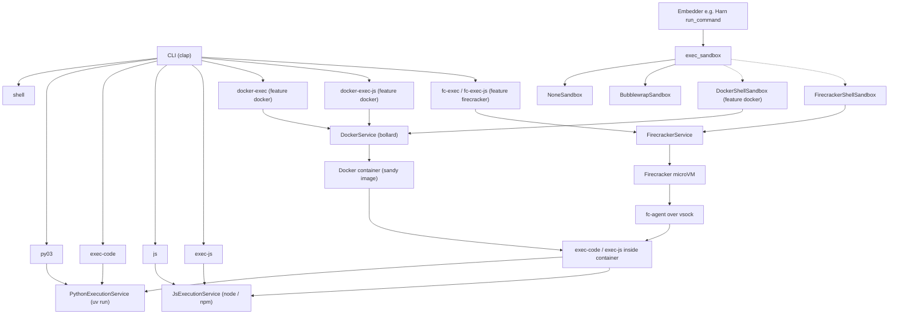

# Architecture

This document describes how **sandy** is structured and how execution flows through the CLI and services.

## High-level diagram

**Note:** In Docker mode, the host process uses `DockerService`, which starts a container whose entrypoint runs the **sandy** binary. Inside the container, `exec-code` uses `PythonExecutionService` (`uv run`) and `exec-js` uses `JsExecutionService` (`node`).

## Crate layout

| Path | Role |
|------|------|
| `src/main.rs` | Binary entry: tracing init, `Cli::parse()`, dispatch to command handlers |
| `src/lib.rs` | Public API: re-exports CLI types and service types |
| `src/cli/mod.rs` | `Cli` / `Commands` definitions (Clap) |
| `src/cli/commands/*.rs` | One module per subcommand (`shell`, `py03`, `exec_code`, `js`, `exec_js`, `docker_exec` / `docker_exec_js` when `docker` enabled) |
| `src/exec_sandbox/` | Pluggable shell sandbox: `CommandSandbox`, `NoneSandbox`, `BubblewrapSandbox`, optional `DockerShellSandbox` |
| `src/service/mod.rs` | `PythonExecutionService`, `ExecutionResult`, `PythonExecutionError` |
| `src/service/js.rs` | `JsExecutionService`, `JsExecutionError` |
| `src/service/docker/` | `SandboxConfig`, `DockerConfig`, `DockerError`, `DockerService` (Bollard client, `docker` feature) |
| `src/service/firecracker/` | `FirecrackerConfig`, `FirecrackerService`, vsock protocol, and guest agent (`firecracker` feature) |

## Cargo features

| Feature | Enables |
|---------|---------|
| *(none)* | Local Python (`PythonExecutionService`), local JavaScript (`JsExecutionService`), `exec_sandbox` (none + bubblewrap) |
| `python-bindings` | PyO3 `sandy._native` module |
| `docker` | bollard, `DockerService`, `docker-exec` / `docker-exec-js` CLI, `DockerShellSandbox`, Python `execute_python_docker` / `execute_javascript_docker` |
| `firecracker` | `FirecrackerService`, `fc-exec` / `fc-exec-js`, `FirecrackerShellSandbox`, and Firecracker Python bindings |
| `exec-sandbox` | Empty marker for dependents; library always includes `exec_sandbox` |

## Python bindings (PyO3 + maturin)

The published wheel is a **mixed** Rust/Python project:

| Path | Role |
|------|------|
| `python/sandy/__init__.py` | Public `import sandy`: wraps native Docker and Firecracker execution and applies optional script preparation. |
| `python/sandy/script_prep.py` | `prepare_script`, `prepare_js_script`, merge/bootstrap helpers. |
| `sandy._native` (cdylib) | Low-level Docker and Firecracker execution functions, gated by their Cargo features. |

Optional **`global_dependencies`** / **`bootstrap_python`** are documented in the [README](../README.md) (Python section). Embedders that inject their own preamble should call `prepare_script` first, then append env/stdin setup, then execute.

## Execution modes

### Local (`PythonExecutionService`)

- Invokes `uv run` with a `.py` path (script file or temporary file for inline code).
- Scripts can use **uv [PEP 723 inline script metadata](https://docs.astral.sh/uv/guides/scripts/#declaring-script-dependencies)** (`# /// script` … `# ///` with `# dependencies = [...]` inside the block), as in [`__scripts__/requests_test.py`](../__scripts__/requests_test.py).
- **Streaming** APIs print stdout line-by-line; stderr is logged via `tracing::error!` in streaming mode and also aggregated in `ExecutionResult`.

### Local (`JsExecutionService`)

- Invokes **`node`** on a `.js` / `.mjs` path (script file or temporary `.mjs` for inline code).
- Scripts can use a **`// /// script`** block (same TOML as PEP 723) listing npm specs. Sandy writes a temp workspace, runs **`npm install --ignore-scripts`**, then `node`.
- Without a dependency block, the original file is executed in place (cwd is the script’s directory).

### Shell sandbox (`exec_sandbox`)

For arbitrary shell commands (not Python), embedders use `sandy::exec_sandbox`:

| Backend | Requires | Notes |
|---------|----------|-------|
| `NoneSandbox` | nothing | Plain `sh -c` in workspace cwd |
| `BubblewrapSandbox` | `bwrap` on Linux | Read-only root + writable bind mounts, optional `--unshare-net` |
| `DockerShellSandbox` | `docker` feature + daemon | Alpine shell container with workspace bind-mount |
| `FirecrackerShellSandbox` | `firecracker` feature + Linux KVM + guest artifacts | MicroVM shell with workspace tar transfer |

`select_backend(SandboxSelection)` picks a backend and returns `Result`. `Auto` prefers bubblewrap → docker (if compiled). When none of those are available it warns, increments `none_sandbox_fallback_count()`, and returns `NoneSandbox` unless `fail_closed` is set (then it returns `SandboxError::Unavailable`). Explicit `ExecBackend::None` still selects none.
Firecracker is explicit because it needs KVM, a kernel, and a rootfs. Default `fail_closed` is **false** so existing Rust embedders keep the old fallback. Set `fail_closed: true` to match sandy-js.

### Docker (`DockerService`, feature `docker`)

- Talks to the Docker API via **bollard**.
- Typical path for `docker-exec`: create a **new** container, run `exec-code --code ...`, collect logs, remove the container (`execute_python_code` → `run_command_with_mounts_and_cleanup`).
- **Persistent** workflows use `create_persistent_container` (shell + `sleep infinity`), then `execute_python_code_in_container` / `exec_in_container` for reuse.

### Firecracker (`FirecrackerService`, feature `firecracker`)

- Runs on Linux with `/dev/kvm`, a kernel image, and an ext4 rootfs.
- Starts one Firecracker process per request and configures it through a Unix API socket.
- Sends Python, JavaScript, and shell requests to `fc-agent` over a Firecracker vsock.
- Starts without a network interface. A caller can provide a pre-created TAP device.
- Transfers shell workspaces as tar archives because Firecracker has no bind mounts.

## Output formats

| Mode | Consumer-facing output |
|------|-------------------------|
| `shell` | Interactive prompt; echoes input (extensible) |
| `py03` / `exec-code` / `js` / `exec-js` | Plain **stdout** (streaming), stderr on failure path, process **exit code** |
| `docker-exec` / `docker-exec-js` | **XML** document: `<execution>` with `<output>` (`stdout`, `stderr`) and `<metrics>` (timestamps, duration, `exit_code`) |
| `fc-exec` / `fc-exec-js` | **XML** document with the same output and metrics fields |

XML content is escaped (`&`, `<`, `>`, quotes) for safe embedding.

## Configuration surfaces

- **Local**: `SandboxConfig` limits (timeout, output size, `UV_PYTHON`) for `PythonExecutionService`; no Docker daemon.
- **exec_sandbox**: `ExecPolicy` (cwd, writable roots, network) separate from Docker resource limits in `SandboxConfig`.
- **Docker**: `DockerConfig` (`image_name`, `image_tag`, `dockerfile_path`, `build_context`) — used when constructing `DockerService` and documented in [Docker guide](docker.md).

## Related reading

- [CLI reference](cli-reference.md)
- [Docker guide](docker.md)
- [Library API](api.md)
- [Development](development.md)
