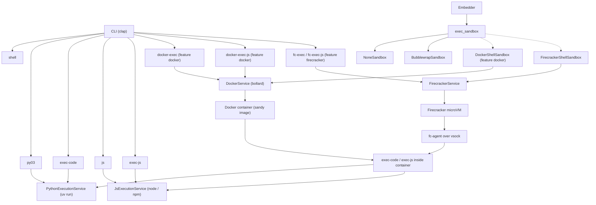

# Architecture

This document describes the sandy crate and the path from a caller to a sandbox.

## Data flow

In Docker mode, the host process uses `DockerService`. The container entrypoint is the `sandy` binary. Inside the container, `exec-code` uses `PythonExecutionService` and `exec-js` uses `JsExecutionService`.

## Crate layout

| Path | Role |
| --- | --- |
| `src/main.rs` | Binary entry. Starts tracing, parses `Cli`, and dispatches a command. |
| `src/lib.rs` | Public re-exports |
| `src/cli/` | Clap types and one module per subcommand |
| `src/exec_sandbox/` | Shell sandbox: `CommandSandbox`, `NoneSandbox`, `BubblewrapSandbox`, optional Docker and Firecracker shells |
| `src/service/mod.rs` | `PythonExecutionService` |
| `src/service/js.rs` | `JsExecutionService` |
| `src/service/docker/` | `DockerService` and `DockerConfig`. Requires the `docker` feature. |
| `src/service/firecracker/` | `FirecrackerService`, the vsock protocol, and the guest agent. Requires the `firecracker` feature. |
| `python/sandy/` | Python package. Wraps `sandy._native`. |
| `sandy-js/` | napi-rs binding for the shell sandbox |
| `.docker/` | Image build |
| `.firecracker/` | Kernel, rootfs, and install helpers |

## Cargo features

| Feature | Enables |
| --- | --- |
| *(none required)* | Local Python, local JavaScript, and `exec_sandbox` (`NoneSandbox` and `BubblewrapSandbox`) |
| `python-bindings` | PyO3 module `sandy._native` |
| `docker` | bollard, `DockerService`, the Docker CLI commands, `DockerShellSandbox`, and the Python Docker helpers |
| `firecracker` | `FirecrackerService`, the Firecracker CLI commands, `FirecrackerShellSandbox`, and the Python Firecracker helpers |
| `exec-sandbox` | Empty marker for dependents. The library always includes `exec_sandbox`. |

## Python package

| Path | Role |
| --- | --- |
| `python/sandy/__init__.py` | Public `import sandy`. Prepares a script, then calls the native helpers. |
| `python/sandy/script_prep.py` | `prepare_script`, `prepare_js_script`, and the merge helpers |
| `sandy._native` | Low-level Docker and Firecracker calls. Each call needs its Cargo feature. |

**Warning:** `global_dependencies` and bootstrap source are trusted caller input. They run in the same sandbox as the user script.

An embedder that injects its own preamble calls `prepare_script` first. It then appends environment setup and runs the script.

## Execution modes

### Local Python

`PythonExecutionService` runs `uv run` on a `.py` path. Inline code is written to a temporary file. Scripts can use [PEP 723 metadata](https://docs.astral.sh/uv/guides/scripts/#declaring-script-dependencies). Streaming APIs print stdout line by line. Stderr is logged with `tracing` and stored on `ExecutionResult`.

### Local JavaScript

`JsExecutionService` runs `node` on a `.js` or `.mjs` path. A leading `// /// script` block lists npm packages. Sandy writes a temporary workspace, runs `npm install --ignore-scripts`, then runs `node`. A file with no dependency block runs in place. The working directory is the script directory.

### Shell sandbox

Embedders use `sandy::exec_sandbox` for a shell command.

| Backend | Requires | Notes |
| --- | --- | --- |
| `NoneSandbox` | nothing | Runs `sh -c` in the workspace |
| `BubblewrapSandbox` | `bwrap` on Linux | Read-only root, writable bind mounts, optional `--unshare-net` |
| `DockerShellSandbox` | `docker` feature and a daemon | Alpine shell container. The workspace is a bind mount. |
| `FirecrackerShellSandbox` | `firecracker` feature, Linux KVM, and guest artifacts | MicroVM shell. The workspace moves as a tar archive. |

`select_backend` returns a `Result`. `Auto` prefers bubblewrap, then Docker when that feature is compiled. When neither backend is available, it warns, increments `none_sandbox_fallback_count()`, and returns `NoneSandbox`. Set `fail_closed` to return `SandboxError::Unavailable` instead. `sandy-js` sets `fail_closed`. Explicit `ExecBackend::None` still selects the unsandboxed backend. Firecracker is explicit because it needs KVM, a kernel, and a rootfs.

### Docker

`DockerService` talks to the Docker API through bollard. `docker-exec` creates a container, runs `exec-code`, collects logs, and removes the container. A persistent workflow calls `create_persistent_container`, then `execute_python_code_in_container`.

The connection order is `DOCKER_HOST`, the Colima sockets, then the local Docker default.

### Firecracker

`FirecrackerService` runs on Linux with `/dev/kvm`, a kernel image, and an ext4 rootfs. It starts one Firecracker process per request and configures it through a Unix socket. Python, JavaScript, and shell requests go to `fc-agent` over vsock. The VM starts with no network interface. A caller can pass a pre-created TAP device. Shell workspaces move as tar archives because Firecracker has no bind mounts.

## Output

| Mode | Output |
| --- | --- |
| `shell` | Interactive prompt |
| `py03`, `exec-code`, `js`, `exec-js` | Streaming stdout, stderr on failure, and the process exit code |
| `docker-exec`, `docker-exec-js`, `fc-exec`, `fc-exec-js` | One XML `<execution>` document with stdout, stderr, and metrics |

XML text escapes `&`, `<`, `>`, and quotes.

## Configuration

- Local Python uses `SandboxConfig` for the timeout, the output limit, and `UV_PYTHON`.
- `exec_sandbox` uses `ExecPolicy` for the working directory, writable roots, and network access.
- Docker uses `DockerConfig` for the image name, the tag, the Dockerfile path, and the build context. See the [Docker guide](docker.md).

## Related

- [CLI reference](cli-reference.md)
- [Docker guide](docker.md)
- [Firecracker guide](firecracker.md)
- [Library API](api.md)
- [Development](development.md)
